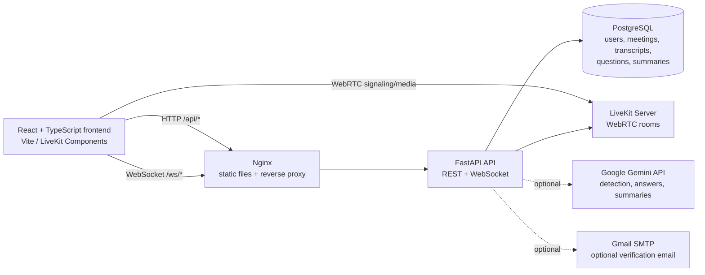
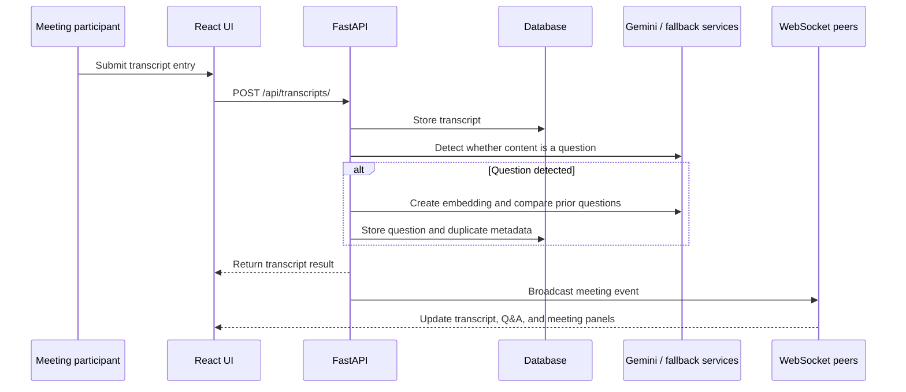
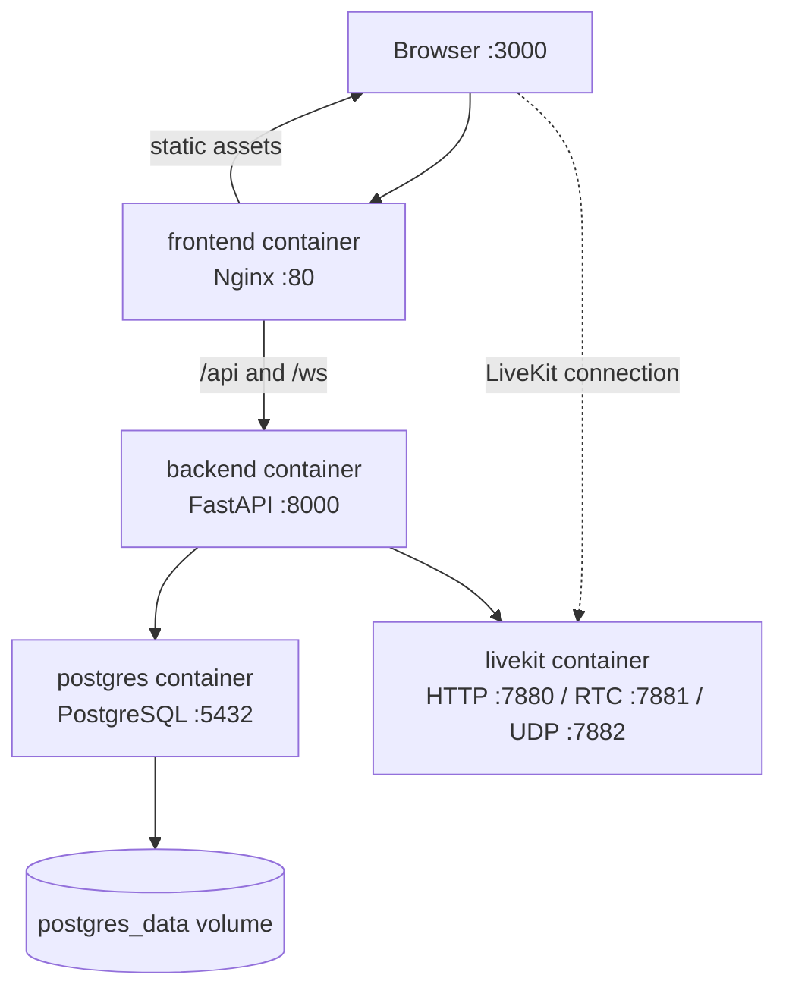
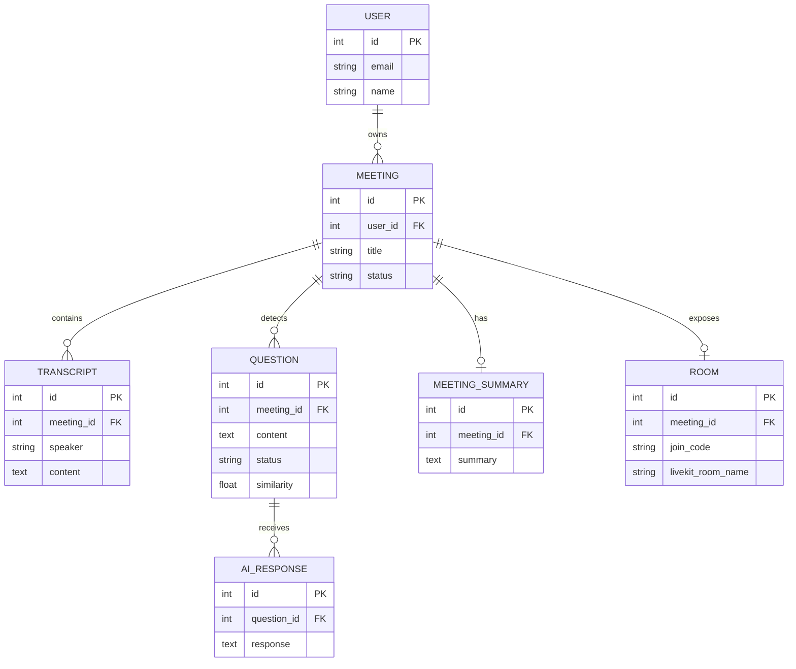

# MeetAI

> An AI-powered meeting workspace for live collaboration, searchable transcripts, intelligent Q&A, and actionable summaries.

MeetAI combines video meetings with an AI meeting assistant. Users can create meetings, invite guests with a join code, collaborate in a LiveKit room, capture transcript entries, detect and group questions, generate contextual answers, and review summaries and analytics after the meeting.

## Highlights

- **Live meeting rooms** powered by LiveKit WebRTC
- **Real-time collaboration** over WebSockets
- **Transcript capture** with automatic question detection
- **Duplicate question detection** using embeddings and cosine similarity
- **Context-aware AI answers** using meeting transcript context
- **AI-generated summaries** with decisions and action items
- **Searchable meeting history**
- **Per-meeting and overall analytics**
- **JWT authentication** with user-owned meeting isolation
- **SQLite for lightweight development** and PostgreSQL for deployment
- **Heuristic fallbacks** when Gemini is not configured

## Architecture

### System overview



In local development, Vite serves the frontend directly and proxies API requests to FastAPI. In the Docker setup, Nginx serves the compiled frontend and proxies `/api/` and `/ws/` to the backend.

### Transcript and question processing



### Deployment topology



## Tech stack

| Layer | Technologies |
| --- | --- |
| Frontend | React 19, TypeScript, Vite, React Router, Tailwind CSS, LiveKit Components |
| Backend | Python 3.12, FastAPI, Pydantic v2, SQLAlchemy 2 |
| Persistence | PostgreSQL 16, SQLite fallback, Alembic migrations |
| AI | Google Gemini, NumPy embeddings, heuristic fallbacks |
| Real-time | LiveKit WebRTC and FastAPI WebSockets |
| Authentication | JWT, Passlib/bcrypt |
| Deployment | Docker Compose, Nginx |

## Quick start

### Prerequisites

- Python 3.12+
- Node.js 20+
- npm
- Docker Desktop (recommended for PostgreSQL and LiveKit)

### Option A: Docker Compose

Build the frontend once, then start the complete stack:

```bash
git clone https://github.com/Iamabhipandat/MeetAi.git
cd MeetAi

cp backend/.env.example backend/.env
# Edit backend/.env and set a strong SECRET_KEY.
# GEMINI_API_KEY and Gmail settings are optional.

cd frontend
npm ci
npm run build
cd ..

docker compose up --build
```

Open:

- Frontend: <http://localhost:3000>
- API: <http://localhost:8000>
- Swagger UI: <http://localhost:8000/docs>
- ReDoc: <http://localhost:8000/redoc>
- Health check: <http://localhost:8000/health>

The Compose frontend container serves `frontend/dist`, so rerun `npm run build` after frontend changes.

### Option B: Local development

#### Backend

```bash
cd backend
python -m venv .venv

# macOS/Linux
source .venv/bin/activate

# Windows PowerShell
# .venv\Scripts\Activate.ps1

pip install -r requirements.txt
cp .env.example .env
uvicorn app.main:app --reload --port 8000
```

The default `.env.example` uses SQLite, so PostgreSQL is not required for a basic local run. To use PostgreSQL, set `DATABASE_URL` or the `POSTGRES_*` variables.

#### Frontend

In a second terminal:

```bash
cd frontend
npm ci
npm run dev
```

Open <http://localhost:5173>. The Vite configuration proxies `/api` and `/ws` to the backend during development.

#### LiveKit

For video rooms, start LiveKit separately:

```bash
docker compose up livekit
```

The default development configuration uses:

```text
LIVEKIT_URL=ws://localhost:7880
LIVEKIT_API_KEY=devkey
LIVEKIT_API_SECRET=secret
```

## Configuration

Copy `backend/.env.example` to `backend/.env` and adjust values as needed.

| Variable | Required | Purpose |
| --- | --- | --- |
| `DATABASE_URL` | No | Direct SQLAlchemy URL; defaults to SQLite |
| `POSTGRES_*` | No | PostgreSQL connection settings |
| `SECRET_KEY` | Yes in production | JWT signing key |
| `ACCESS_TOKEN_EXPIRE_MINUTES` | No | JWT lifetime |
| `GEMINI_API_KEY` | No | Enables Gemini-powered AI features |
| `SIMILARITY_THRESHOLD` | No | Duplicate-question threshold; defaults to `0.85` |
| `GMAIL_USER` / `GMAIL_APP_PASSWORD` | No | Email verification via Gmail SMTP |
| `FRONTEND_URL` | No | Frontend URL used in verification links |
| `LIVEKIT_URL` | No | LiveKit WebSocket URL |
| `LIVEKIT_API_KEY` / `LIVEKIT_API_SECRET` | No | LiveKit token signing credentials |

Never commit `.env` files or production credentials.

## API surface

FastAPI generates the complete interactive API reference at `/docs`. The main route groups are:

| Group | Representative endpoints |
| --- | --- |
| Authentication | `POST /api/auth/register`, `POST /api/auth/login`, `GET /api/auth/me` |
| Meetings | `GET/POST /api/meetings/`, `POST /api/meetings/{id}/start`, `POST /api/meetings/{id}/finish` |
| Rooms | `POST /api/rooms/{meeting_id}/create`, `GET /api/rooms/join/{join_code}`, token endpoints for hosts and guests |
| Transcripts | `POST /api/transcripts/`, `GET /api/transcripts/meeting/{meeting_id}` |
| Questions | `GET /api/questions/meeting/{meeting_id}`, `PATCH /api/questions/{id}/status` |
| AI responses | `POST /api/ai/questions/{id}/answer`, `GET /api/ai/questions/{id}/responses` |
| Summaries | `GET /api/summaries/meeting/{meeting_id}` |
| Search | `GET /api/search/?q=query&limit=20` |
| Analytics | `GET /api/analytics/` |
| Real-time events | `ws://localhost:8000/ws/meetings/{meeting_id}` |

## Testing and quality checks

### Backend tests

```bash
cd backend
pytest -v
```

### Frontend checks

```bash
cd frontend
npm run build
npm run lint
```

## Project structure

```text
MeetAi/
├── backend/
│   ├── app/
│   │   ├── core/                 # Configuration, database, security
│   │   ├── models/               # SQLAlchemy entities
│   │   ├── routers/              # REST and WebSocket-facing API routes
│   │   ├── schemas/              # Pydantic request/response models
│   │   ├── services/             # AI, search, summaries, email, LiveKit
│   │   ├── websocket_manager.py  # Meeting event fan-out
│   │   └── main.py               # FastAPI application
│   ├── alembic/                  # Database migration history
│   ├── tests/                    # API and service tests
│   ├── Dockerfile
│   └── requirements.txt
├── frontend/
│   ├── src/
│   │   ├── components/           # Shared UI and meeting components
│   │   ├── contexts/             # Auth and theme state
│   │   ├── pages/                # Dashboard, meeting, search, analytics, room
│   │   └── lib/                  # API client, types, utilities
│   ├── package.json
│   └── vite.config.ts
├── docker-compose.yml             # PostgreSQL, LiveKit, API, Nginx
├── nginx.conf                     # SPA fallback and API/WebSocket proxy
└── .gitignore
```

## Data model



## Contributing

1. Create a focused branch from the default branch.
2. Keep API and UI changes covered by the relevant tests.
3. Run backend tests and frontend build/lint checks before opening a pull request.
4. Document new environment variables, routes, or operational requirements.

## License

MIT
